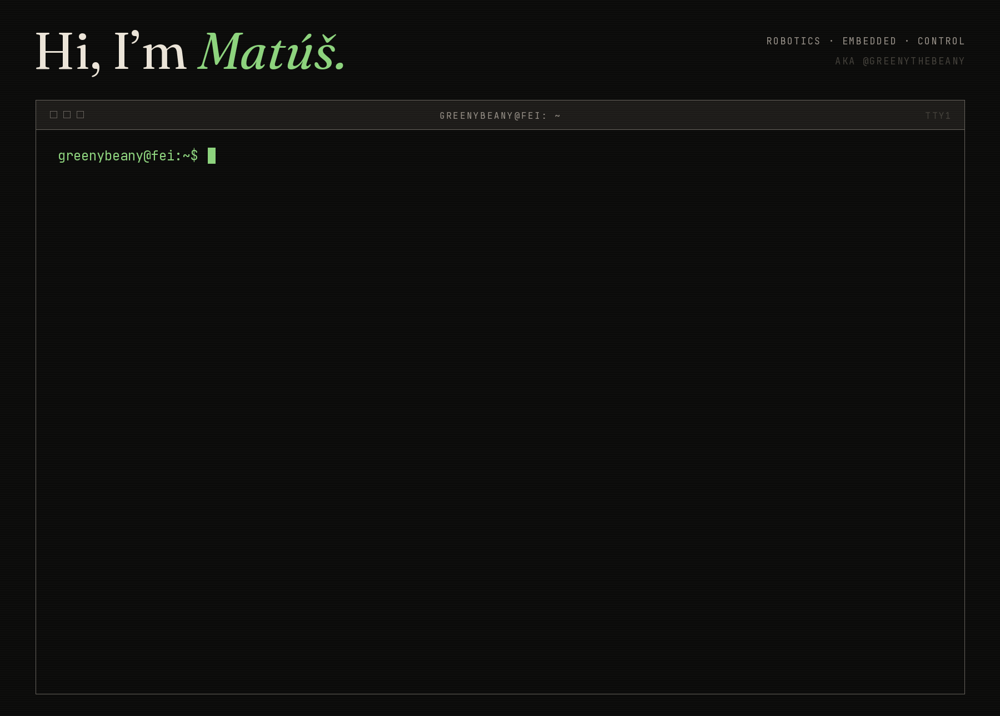
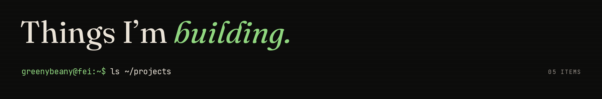
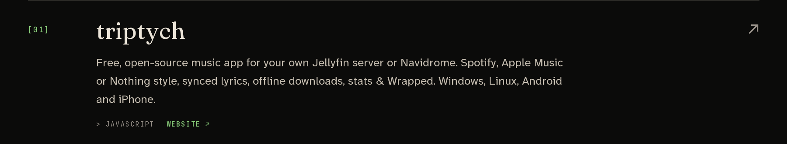
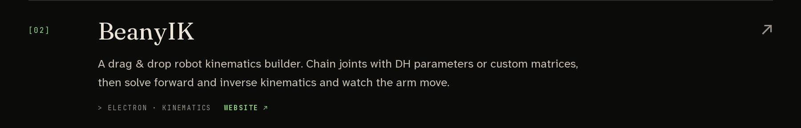
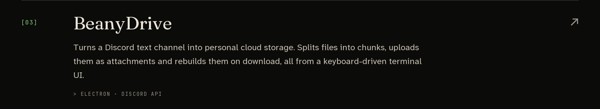
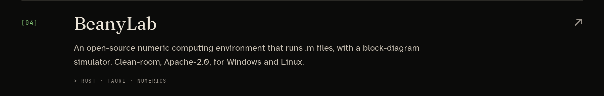
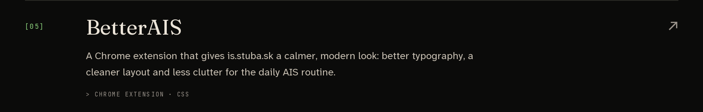
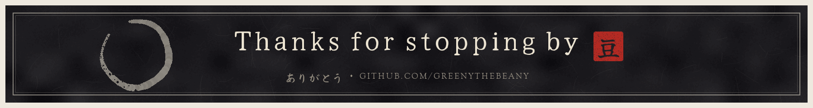

<a href="https://greenybeany.dev/me/" title="greenybeany.dev/me">
  <picture>
    <source media="(prefers-color-scheme: dark)" srcset="hero-dark.gif">
    <source media="(prefers-color-scheme: light)" srcset="hero-light.gif">
    
  </picture>
</a>

<picture>
  <source media="(prefers-color-scheme: dark)" srcset="projects-dark.png">
  <source media="(prefers-color-scheme: light)" srcset="projects-light.png">
  
</picture>

<a href="https://triptych.greenybeany.dev/" title="triptych — open-source music app for Jellyfin and Navidrome">
  <picture>
    <source media="(prefers-color-scheme: dark)" srcset="project-triptych-dark.png">
    <source media="(prefers-color-scheme: light)" srcset="project-triptych-light.png">
    
  </picture>
</a>

<a href="https://greenybeany.dev/BeanyIK/" title="BeanyIK — drag &amp; drop robot kinematics builder">
  <picture>
    <source media="(prefers-color-scheme: dark)" srcset="project-beanyik-dark.png">
    <source media="(prefers-color-scheme: light)" srcset="project-beanyik-light.png">
    
  </picture>
</a>

<a href="https://github.com/Greenythebeany/BeanyDrive" title="BeanyDrive — a Discord channel as personal cloud storage">
  <picture>
    <source media="(prefers-color-scheme: dark)" srcset="project-beanydrive-dark.png">
    <source media="(prefers-color-scheme: light)" srcset="project-beanydrive-light.png">
    
  </picture>
</a>

<a href="https://github.com/Greenythebeany/BeanyLab" title="BeanyLab — open-source numeric computing environment">
  <picture>
    <source media="(prefers-color-scheme: dark)" srcset="project-beanylab-dark.png">
    <source media="(prefers-color-scheme: light)" srcset="project-beanylab-light.png">
    
  </picture>
</a>

<a href="https://github.com/Greenythebeany/BetterAis" title="BetterAIS — a calmer is.stuba.sk">
  <picture>
    <source media="(prefers-color-scheme: dark)" srcset="project-betterais-dark.png">
    <source media="(prefers-color-scheme: light)" srcset="project-betterais-light.png">
    
  </picture>
</a>

<picture>
  <source media="(prefers-color-scheme: dark)" srcset="contributions-dark.svg">
  <source media="(prefers-color-scheme: light)" srcset="contributions-light.svg">
  
</picture>

<a href="https://github.com/Greenythebeany?tab=repositories" title="All repositories on GitHub">
  <picture>
    <source media="(prefers-color-scheme: dark)" srcset="footer-dark.gif">
    <source media="(prefers-color-scheme: light)" srcset="footer-light.gif">
    
  </picture>
</a>
