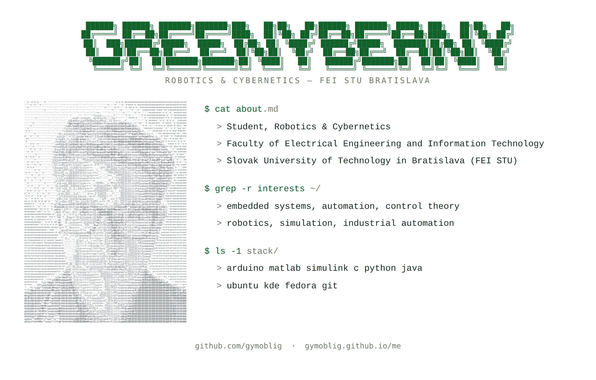
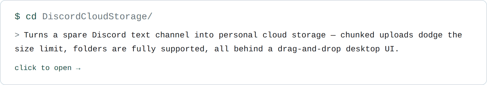
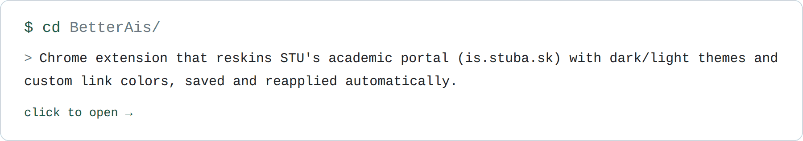
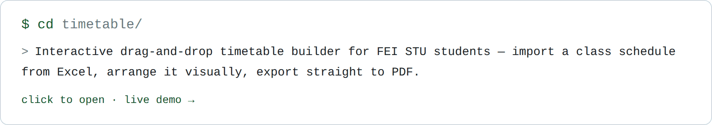

<picture>
  <source media="(prefers-color-scheme: dark)" srcset="hero-dark.png">
  <source media="(prefers-color-scheme: light)" srcset="hero-light.png">
  
</picture>

---

<a href="https://github.com/Greenythebeany/DiscordCloudStorage" title="DiscordCloudStorage — personal cloud storage over a Discord text channel">
  <picture>
    <source media="(prefers-color-scheme: dark)" srcset="card-discordcloudstorage-dark.png">
    <source media="(prefers-color-scheme: light)" srcset="card-discordcloudstorage-light.png">
    
  </picture>
</a>

<a href="https://github.com/Greenythebeany/BetterAis" title="BetterAis — Chrome extension that reskins STU's academic portal">
  <picture>
    <source media="(prefers-color-scheme: dark)" srcset="card-betterais-dark.png">
    <source media="(prefers-color-scheme: light)" srcset="card-betterais-light.png">
    
  </picture>
</a>

<a href="https://github.com/Greenythebeany/timetable" title="timetable — drag-and-drop timetable builder for FEI STU">
  <picture>
    <source media="(prefers-color-scheme: dark)" srcset="card-timetable-dark.png">
    <source media="(prefers-color-scheme: light)" srcset="card-timetable-light.png">
    
  </picture>
</a>

---

<picture>
  
</picture>

---

  

---

  <code>$ exit 0</code> &nbsp;&middot;&nbsp; thanks for stopping by

