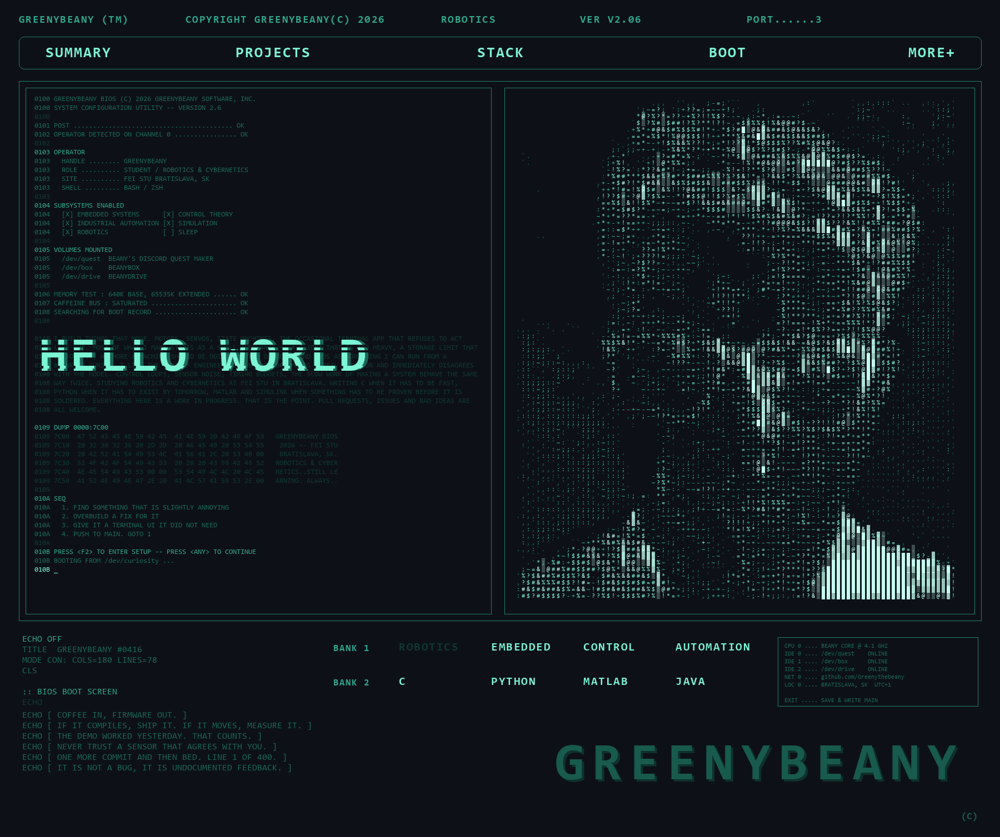
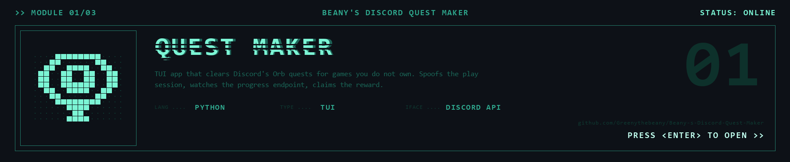
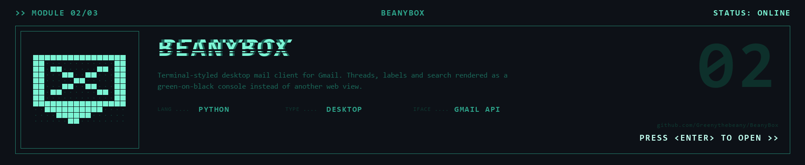
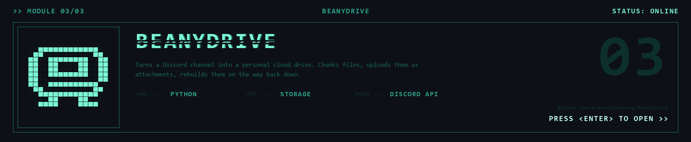
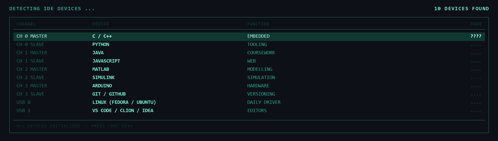

<picture>
  <source media="(prefers-color-scheme: dark)" srcset="hero-dark.gif">
  <source media="(prefers-color-scheme: light)" srcset="hero-light.gif">
  
</picture>

<a href="https://github.com/Greenythebeany/Beany-s-Discord-Quest-Maker" title="Beany's Discord Quest Maker — TUI app that clears Discord's Orb quests for games you don't own">
  <picture>
    <source media="(prefers-color-scheme: dark)" srcset="card-questmaker-dark.gif">
    <source media="(prefers-color-scheme: light)" srcset="card-questmaker-light.gif">
    
  </picture>
</a>

<a href="https://github.com/Greenythebeany/BeanyBox" title="BeanyBox — terminal-styled desktop mail client for Gmail">
  <picture>
    <source media="(prefers-color-scheme: dark)" srcset="card-beanybox-dark.gif">
    <source media="(prefers-color-scheme: light)" srcset="card-beanybox-light.gif">
    
  </picture>
</a>

<a href="https://github.com/Greenythebeany/BeanyDrive" title="BeanyDrive — turns a Discord channel into a personal cloud drive">
  <picture>
    <source media="(prefers-color-scheme: dark)" srcset="card-beanydrive-dark.gif">
    <source media="(prefers-color-scheme: light)" srcset="card-beanydrive-light.gif">
    
  </picture>
</a>

<picture>
  <source media="(prefers-color-scheme: dark)" srcset="stack-dark.gif">
  <source media="(prefers-color-scheme: light)" srcset="stack-light.gif">
  
</picture>

<picture>
  
</picture>

<picture>
  <source media="(prefers-color-scheme: dark)" srcset="footer-dark.gif">
  <source media="(prefers-color-scheme: light)" srcset="footer-light.gif">
  
</picture>
