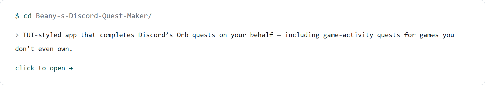
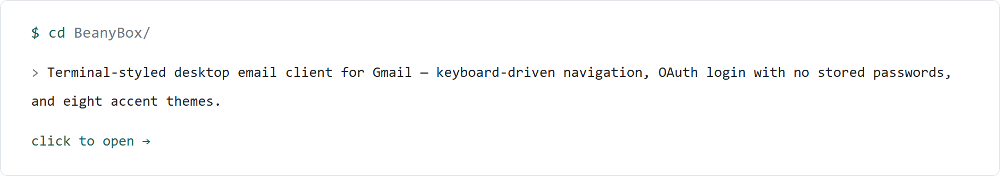
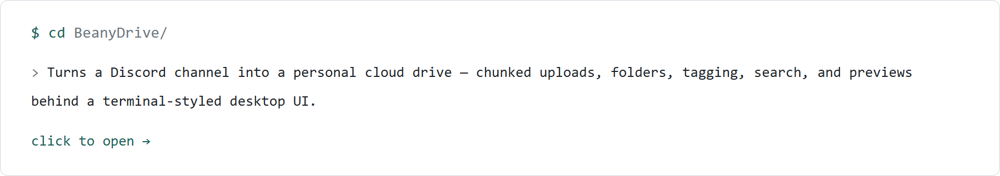

<picture>
  <source media="(prefers-color-scheme: dark)" srcset="hero-dark.png">
  <source media="(prefers-color-scheme: light)" srcset="hero-light.png">
  
</picture>

---

<a href="https://github.com/Greenythebeany/Beany-s-Discord-Quest-Maker" title="Beany's Discord Quest Maker — TUI app that completes Discord's Orb quests for games you don't own">
  <picture>
    <source media="(prefers-color-scheme: dark)" srcset="card-questmaker-dark.png">
    <source media="(prefers-color-scheme: light)" srcset="card-questmaker-light.png">
    
  </picture>
</a>

<a href="https://github.com/Greenythebeany/BeanyBox" title="BeanyBox — terminal-styled desktop email client for Gmail">
  <picture>
    <source media="(prefers-color-scheme: dark)" srcset="card-beanybox-dark.png">
    <source media="(prefers-color-scheme: light)" srcset="card-beanybox-light.png">
    
  </picture>
</a>

<a href="https://github.com/Greenythebeany/BeanyDrive" title="BeanyDrive — turns a Discord channel into a personal cloud drive">
  <picture>
    <source media="(prefers-color-scheme: dark)" srcset="card-beanydrive-dark.png">
    <source media="(prefers-color-scheme: light)" srcset="card-beanydrive-light.png">
    
  </picture>
</a>

---

<picture>
  
</picture>

---

  

---

  <code>$ exit 0</code> &nbsp;&middot;&nbsp; thanks for stopping by

